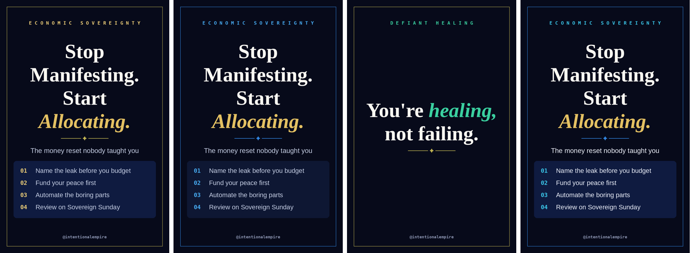

# Intentional Empire: Viral Engines ✦

Two Claude Code engines live here: **Pinterest Viral Engine** and **GTA 6 Viral Clipper** (see the end of this file).

## Pinterest Viral Engine

A Claude Code **skill + agent** that researches Pinterest trends, decodes why pins go viral, and rebuilds those patterns for Intentional Empire in the brand's Blue ✦ Green ✦ Gold palette.



## What's inside
| Path | Role |
|---|---|
| `.claude/skills/pinterest-viral-empire/SKILL.md` | The 5-phase Empire Loop: Intake → Trend Recon → Decode DNA → Empire Remix → Produce |
| `.claude/agents/pinterest-trend-scout.md` | Research subagent that writes a cited trend brief |
| `.../brand.json` | **Brand colors & fonts. Edit the hex codes here.** |
| `.../references/` | Brand kit, research playbook, 12 viral archetypes, compliance guardrails |
| `.../templates/` | Trend brief + pin pack formats, example render spec |
| `.../scripts/score_pins.py` | Ranks pins by velocity and outlier score from a CSV |
| `.../scripts/render_pin.py` | Renders branded 1000×1500 pins (`--all-colorways` for A/B variants) |

## Use it
Open this repo in Claude Code and say things like:
- "Run a Pinterest sprint for Economic Sovereignty"
- "Trend scout: what's rising in healing and money mindset for January?"
- "Remix these 5 viral pins for my brand" (paste links or screenshots)

Quick render:
```bash
python3 .claude/skills/pinterest-viral-empire/scripts/render_pin.py \
  .claude/skills/pinterest-viral-empire/templates/example-spec.json --out pins --all-colorways
```

**Principle:** copy the *pattern*, never the pin. Every remix passes a Transformation Test and a financial-compliance check.

---

## GTA 6 Viral Clipper 🎮
**Tools:** vidIQ (numbers) + Genspark (research beyond YouTube, scripts, visuals).

A skill + scout agent that finds the GTA 6 / Rockstar moments spreading **right now** across 4 tiers (official → creators → community → search demand), scores them, and turns them into clip briefs.

| Path | Role |
|---|---|
| `.claude/skills/gta6-viral-clipper/SKILL.md` | The 5-step Heat Loop: Intake → Scout → Decode → Remix → Rights Gate |
| `.claude/agents/gta6-clip-scout.md` | Research subagent (web + vidIQ) that writes a scored, cited scout report |
| `.../references/` | Source map, 12 clip archetypes, rights and safety rules, vidIQ playbook and credit budget, **Genspark playbook** |
| `.../templates/genspark-prompts.md` | Paste-ready Genspark prompts (community pulse, Rockstar digest, streamer moments, fact check, script, AI image and video) |
| `.../templates/` | Scout report and clip brief formats |
| `.../scripts/score_clips.py` | Ranks signals by velocity, outlier strength, engagement and freshness, and labels each NOW / RIDE / LATE |
| `.../scripts/pulse.py` + `references/hourly-pulse.md` | **Hourly Pulse**: a free hourly scan, GO-LIVE push alerts and a 60-minute go-live playbook. Every scan ends with a deduplicated digest ranked by virality score, with the top pick marked USE FIRST |
| `samples/` | Two stock-footage sample Shorts plus credits |
| `scout-report-2026-11-19.md` | Launch-day scout report |

**Install anywhere:**
- *Claude Code:* open this repo. The skill and agent load from `.claude/`.
- *Claude.ai:* upload `dist/gta6-viral-clipper.zip` under Settings → Capabilities → Skills. The scout agent's instructions are included in `agents/` for reference.

Say: "Run a GTA sprint", "Launch-day scan", or "Turn #1 from the scout report into clip briefs".

```bash
python3 .claude/skills/gta6-viral-clipper/scripts/score_clips.py \
  .claude/skills/gta6-viral-clipper/data/scout-2026-11-19.csv --now 2026-11-19T12:00:00Z
```

**Principle:** own the angle, borrow the moment. Your footage and your take, credit everyone, and never touch leaks.
